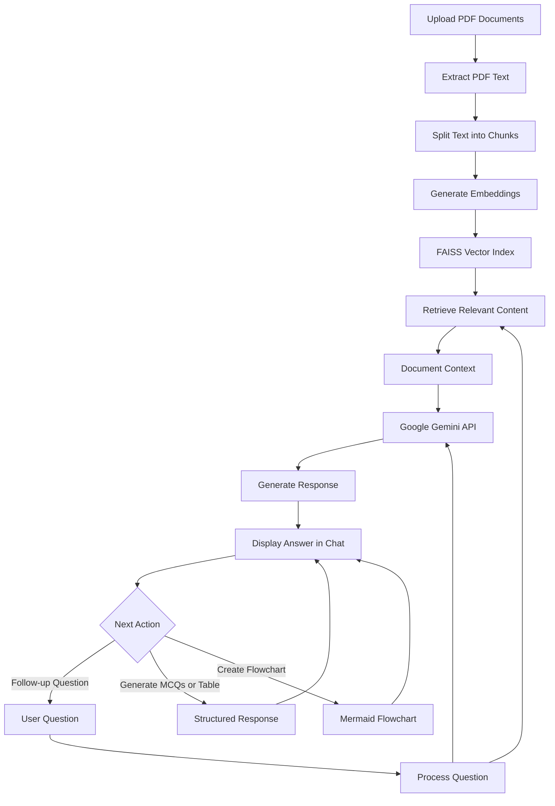

# CampusGPT — AI-Powered Academic Study Assistant

CampusGPT is an AI-powered academic study assistant that enables users to interact with PDF study materials through a conversational interface. Built using Python, Streamlit, Retrieval-Augmented Generation (RAG), and the Google Gemini API, it retrieves relevant document content to support contextual question answering and interactive learning.

## Project Overview

CampusGPT simplifies access to information in academic documents by combining PDF text extraction, semantic retrieval, vector similarity search, and generative AI within an interactive web application.

## Key Features

### 1. Multiple PDF Uploads

* Upload multiple PDF study documents.
* Process uploaded materials for document-based question answering.
* Interact with selected documents through the chat interface.

### 2. RAG-Based Question Answering

* Extract text from uploaded PDFs.
* Divide extracted text into smaller chunks.
* Generate embeddings for semantic representation.
* Use FAISS similarity search to retrieve relevant document sections.
* Provide retrieved context to Gemini for answer generation.

### 3. Context-Aware Responses

* Ask questions about uploaded study materials.
* Receive AI-generated answers based on relevant retrieved content.
* Handle document-based questions through conversational interaction.

### 4. Follow-Up Questions

* Ask follow-up questions to explore topics in greater detail.
* Continue the conversation while using available conversational context.

### 5. MCQ Generation

* Generate multiple-choice questions from study materials.
* Present questions and answer options in a structured format.
* Support self-assessment and academic practice.

### 6. Table Generation

* Present information in table format when requested.
* Organize relevant information into rows and columns.
* Make document-based comparisons easier to understand.

### 7. Flowchart Creation Using Mermaid

* Generate flowcharts using Mermaid syntax.
* Represent supported concepts and processes visually.
* Render Mermaid flowcharts within the application.

### 8. Section References and Citations

* Support section references or citations when source information is available.
* Help users identify the origin of information in uploaded materials.

### 9. Missing-Information Handling

* Handle questions when relevant information is unavailable in the retrieved document content.
* Support responses indicating when the available information is insufficient.

### 10. Chat Management

* **Chat History:** View messages in the current conversation.
* **Clear Chat:** Clear the current conversation using the application's chat controls.

## Technology Stack

| Technology                           | Purpose                                    |
| ------------------------------------ | ------------------------------------------ |
| Python                               | Application logic and document processing  |
| Streamlit                            | Interactive web application interface      |
| Google Gemini API                    | AI-powered response generation             |
| FAISS                                | Vector similarity search                   |
| Text Embeddings                      | Semantic representation of document chunks |
| PDF Processing                       | Text extraction from PDF documents         |
| Retrieval-Augmented Generation (RAG) | Context-based question answering           |
| Mermaid                              | Flowchart creation and rendering           |

## System Architecture



## Application Workflow

1. **Document Upload:** Users upload PDF study materials.
2. **Text Extraction:** The application extracts available text from the documents.
3. **Text Chunking:** Extracted content is divided into smaller sections.
4. **Embedding Generation:** Embeddings are generated for the text chunks.
5. **Vector Indexing:** FAISS indexes embeddings for similarity search.
6. **Question Processing:** The application receives a user's question.
7. **Context Retrieval:** Relevant document sections are retrieved.
8. **Response Generation:** The question and retrieved context are used to generate a response through Gemini.
9. **Response Display:** The generated answer appears in the chat interface, with structured output or Mermaid flowcharts when requested and supported.

## Installation and Setup

### Prerequisites

* Python
* Git
* Google Gemini API key

### Run Locally

Clone the repository:

```bash
git clone https://github.com/vandanagowda006-lgtm/CampusGPT.git
```

Navigate to the project directory:

```bash
cd CampusGPT
```

Install dependencies:

```bash
pip install -r requirements.txt
```

Configure the Gemini API key using the environment or secrets configuration supported by the application.

Start the application:

```bash
streamlit run app.py
```

## Live Application

[Launch CampusGPT](https://campusgpt-klwquhrqvdlqwevv3eha7p.streamlit.app/)

## Security

* Store API credentials securely using environment variables or Streamlit Secrets.
* Never commit API keys or `.env` files to a public repository.
* Keep application dependencies and configuration files organized.

## Project Objective

CampusGPT aims to make academic learning more interactive by combining document retrieval and conversational AI. It provides a unified interface for exploring uploaded study materials, generating learning content, organizing information, and creating Mermaid-based flowcharts.

